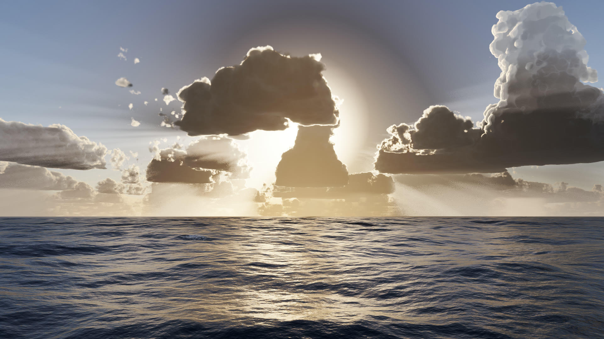
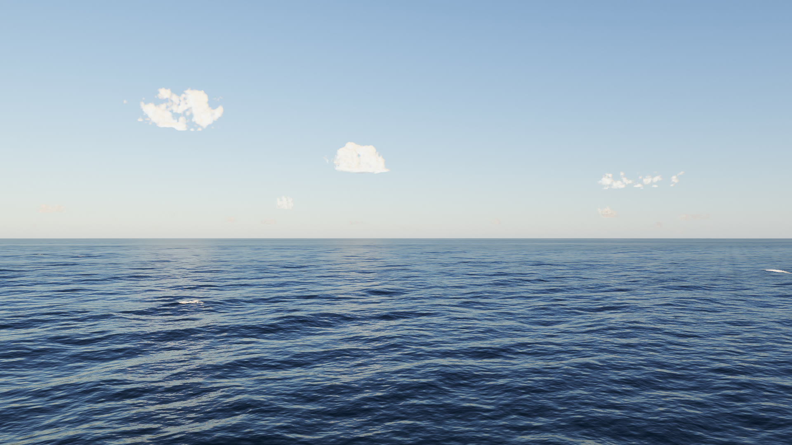
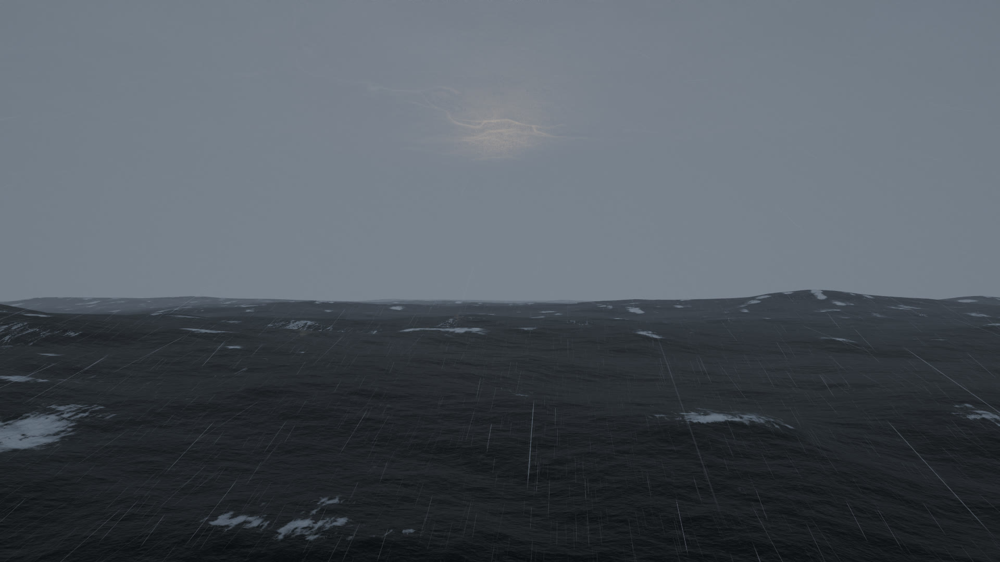
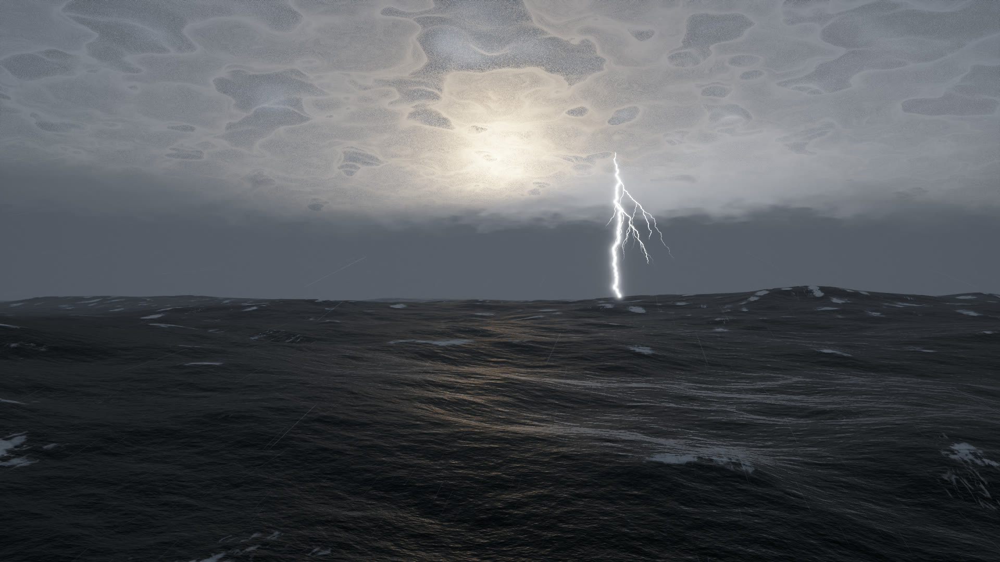

# Ocean Dweller

An endless, physically based ocean in your browser. It runs on three.js and WebGPU with no textures or models: every
wave, cloud, foam bubble and raindrop is computed. Only rain and thunder sounds are recordings.

[](https://github.com/teddybuild/three-js-ocean-dweller/actions/workflows/ci.yml)
[](LICENSE)




| Calm | Rain at 20 m/s | Storm with a ground strike |
| --- | --- | --- |
|  |  |  |

All four images are single frames from this repo's engine, captured with `tools/shot.mjs`.

## Quick start

```bash
git clone https://github.com/teddybuild/three-js-ocean-dweller.git
cd three-js-ocean-dweller
pnpm install
pnpm dev
```

Open http://localhost:5173 in a browser with WebGPU.

| You need | Detail |
| --- | --- |
| Browser | Chrome or Edge. Chrome on Linux is the one this repo checks. There is no WebGL fallback. |
| GPU | Any WebGPU adapter. An RTX 5080 holds the 60 Hz monitor cap at 3840x2160 in the default scene. |
| Tools | pnpm 11 and Node 26, the versions CI runs. |

## Controls

| Input | Action |
| --- | --- |
| Drag | Look around |
| Scroll | Rise or sink. Below about 12 m the camera rides the waves. |
| `1` `2` `3` `4` | Calm, Breeze, Rain, Storm |
| `T` | Tuning sheet: wind, waves, chop, rain, clouds, lightning, sun |
| `L` | Lightning strike |
| `N` | Moonlit night, and back |
| `M` | Sound |
| `H` | Hide the interface |
| `F` | Fullscreen |

Any scene can be linked by URL. For example, http://localhost:5173/?preset=storm&wind=20&yaw=90 opens a storm at
20 m/s wind, facing yaw 90.

| Parameter | Meaning |
| --- | --- |
| `preset` | `calm`, `breeze` (default), `rain`, `storm` |
| `wind`, `waveScale`, `choppy`, `rain`, `clouds`, `lightning` | Any weather key, same units as the tuning sheet |
| `elev`, `az` | Sun height and bearing in degrees |
| `yaw`, `pitch`, `h` | Camera direction in degrees, eye height in metres |
| `q=high` | Film quality: larger FFT sizes |

## What it simulates

| System | Model |
| --- | --- |
| Waves | Tessendorf FFT on the GPU with 4 cascades (1800 m to 3.7 m), Elfouhaily spectrum, heights checked against the Beaufort table |
| Light on water | Slope-variance BRDF after Bruneton et al., sun glitter as individual capillary facets |
| Foam | Whitecaps where the surface folds, coverage calibrated to the Monahan whitecap law |
| Sky | Hillaire atmosphere LUTs, volumetric Perlin-Worley clouds, congestus towers, squall lines |
| Rain and storm | Marshall-Palmer drop sizes, ring waves and splashes, fractal lightning, thunder delayed at 343 m/s |
| Night | Moon as the light source, stars with physical flux, a scotopic colour shift |
| Camera and image | A camera floating on the swell, photographic metering, AgX tone mapping, bloom, film grain |
| Sound | Sea, whitecaps and wind synthesized from the weather state, recorded rain and thunder |

[docs/systems/simulation.md](docs/systems/simulation.md) gives the full model, the measured results and the papers.

## Project layout

| Path | Contents |
| --- | --- |
| `src/three/` | The WebGPU renderer in TypeScript and TSL: FFT, water, foam, sky, clouds, rain, spray, lightning, post |
| `src/` | Boot, weather, interface, audio engine, film timeline |
| `tools/` | Screenshots, regression frames, live-path test, cloud sketch pad |
| `render/` | Offline film renderer |
| `archive/gl/` | The original WebGL2 engine, kept for reference only |
| `docs/` | Architecture, system specs, decision records, status and work logs |

## Develop

| Command | What it does |
| --- | --- |
| `pnpm check` | The gate: `tsc --noEmit`, then `vite build` |
| `pnpm check:secrets` | Scans all history with gitleaks for secrets, emails, private IPs and home paths |
| `node tools/shot.mjs "preset=storm" out.png 1920 1080 3` | One deterministic frame to a PNG (needs `pnpm dev` running) |
| `node tools/diff.mjs all` | Every scene against saved reference frames (make them first with `--update`) |
| `node tools/live-three.mjs` | Live path: render loop, interface, drag, errors, thunder audio |
| `pnpm render --to 5 --out out/clip.mp4` | Renders a film clip through headless Chrome and ffmpeg, frame by frame |

Contributions are welcome. [CONTRIBUTING.md](CONTRIBUTING.md) covers setup, checks and project rules, and
[docs/ARCHITECTURE.md](docs/ARCHITECTURE.md) is the place to start reading the code.

## Limits

- WebGPU only. The FFT runs in compute shaders, and this repo has no fallback by choice.
- No hosted demo. It runs from a local dev server.
- `media/` images without a `now-` prefix come from the upstream WebGL2 engine. Its one-minute film is on the [upstream releases page](https://github.com/Leonxlnx/open-water/releases).

## Credits

This project started as a fork of [open-water](https://github.com/Leonxlnx/open-water) by Leonxlnx (MIT), which created
the ocean, sky, weather and sound models. It ports them to three.js on WebGPU and adds congestus towers and distant
showers. [docs/OSS.md](docs/OSS.md) lists everything reused and its license.

## License

The code is [MIT](LICENSE). The rain and thunder recordings keep their Creative Commons licenses, listed in
[public/audio/CREDITS.md](public/audio/CREDITS.md).
